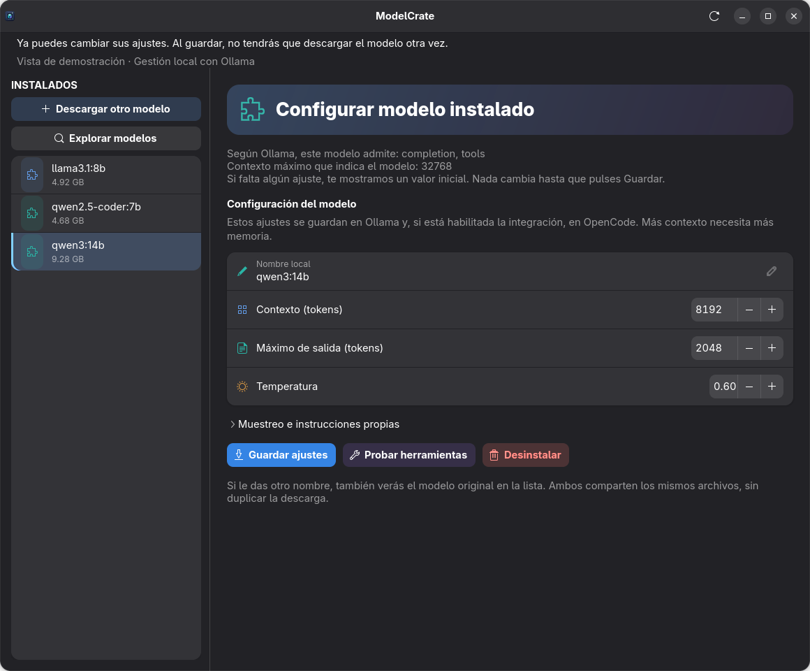
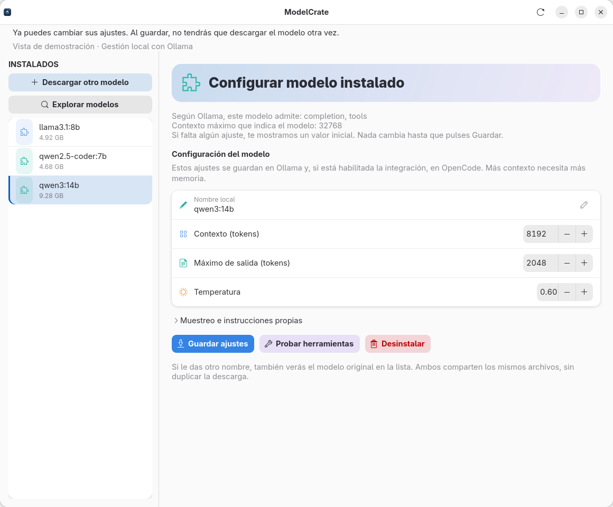

# ModelCrate

**Browse, download and organize local AI models.** A native GTK4/libadwaita desktop manager for Linux, powered by Ollama.

**v0.1.0 — experimental.** Spanish interface. Tested on CachyOS/GNOME. Windows and macOS are not supported. NVIDIA detection has been checked on physical hardware; AMD/Intel recommendation cases are covered by simulated tests, not physical-device validation.

[Guía en español](docs/USAGE.es.md) · [Development](CONTRIBUTING.md) · [Release notes](CHANGELOG.md)

## Screenshots

Real application renders with demonstration data, not a user's private model inventory.

### Dark



### Light



## What it does

- Searches Hugging Face by name or catalog URL, with sorting and pagination.
- Filters the catalog by Ollama, LM Studio or Jan. **These are search filters, not installation targets. Model management uses Ollama only.**
- Lists public, single-file GGUF variants from the repository's `main` branch.
- Suggests a variant using available RAM/VRAM, context and a speed/balance/quality preference. Recommendations are estimates, not guarantees.
- Downloads through Ollama with streaming progress, current-layer byte count, estimated speed and cancellation.
- Edits model parameters without downloading the weights again.
- Optionally updates a compatible existing OpenCode configuration.
- Runs a basic native tool-call check using a synthetic random-code tool, without executing shell commands.
- Uninstalls models through Ollama, with confirmation and metadata backups.

## Requirements

- Linux desktop, Python 3.10+, GTK4, libadwaita **1.4+**, PyGObject and Requests 2.31+.
- A running Ollama server at `http://127.0.0.1:11434`. Install and start it separately using [Ollama's documentation](https://docs.ollama.com/). ModelCrate does not install or enable services.
- Internet access for Hugging Face browsing and model downloads.
- Optional: `nvidia-smi` or `vulkaninfo` for more detailed GPU detection. Missing tools do not block browsing.

Prefer native distribution packages. On Arch/CachyOS:

```bash
sudo pacman -S python python-gobject python-requests gtk4 libadwaita
```

On other distributions, install equivalent packages providing Python `gi`, `requests`, GTK4 and libadwaita introspection. Those environments have not yet been validated. GTK is not installed by `pip install -r requirements.txt`.

## Install from the checkout

From this repository's directory:

```bash
python3 install.py
```

Then open **ModelCrate** in your application menu. No sudo is used by the installer. It creates a launcher in `~/.local/bin` and a desktop entry and icon under `$XDG_DATA_HOME` (default `~/.local/share`). **Keep the checkout in place:** the launcher runs its `app.py`. Rerun the installer after moving the checkout.

Or run directly:

```bash
python3 app.py
```

Remove the launcher without deleting models, sources or settings:

```bash
python3 install.py --uninstall
```

## Optional OpenCode integration

Integration is enabled only when an existing `$XDG_CONFIG_HOME/opencode/opencode.json` has the supported **`providers`** format (provider `settings`, model `limit`/`body`/`capabilities`). This adapter was validated against the v2 configuration used during development. It is not a universal OpenCode adapter and does not infer compatibility from the version name alone.

Missing, malformed, empty, legacy `provider` configurations or conflicting `.jsonc` model settings disable integration. ModelCrate displays the reason and can still manage Ollama. No OpenCode configuration is created automatically. When integration is disabled, deleting a model does not clean up references in other applications. Restart ModelCrate after correcting the external configuration.

Writes preserve unrelated fields, back up the file and check for concurrent edits before replacement. Project-specific overrides and existing conversations may still select another model. No restart of OpenCode is forced.

## Data and backups

- Model weights are managed by **Ollama**, in its own storage. ModelCrate never scans or deletes arbitrary weight directories.
- The original Hugging Face alias is retained when creating a short model name. Ollama shares their weights; removing one alias may free little disk space.
- Default backups and change records: `$XDG_STATE_HOME/modelcrate/{BACKUPS,CAMBIOS}` (usually `~/.local/state/modelcrate`). Weights are **not** backed up.
- An optional `$XDG_CONFIG_HOME/modelcrate/settings.json` can set `{"audit_dir": "/absolute/path/to/backups-and-records"}`. This file belongs to the user and must not be committed.
- Searches send the entered query to Hugging Face. Downloads and model inference use Ollama. No application telemetry is implemented. Model metadata/system prompts may appear in local backups; treat those as private.

## Known limits

- No private/gated repository authentication, sharded GGUF import, separate vision-projector setup or alternate branches.
- GGUF availability does not imply architecture support in the installed Ollama version. Catalog tags are author-supplied metadata.
- Hardware estimation reserves a heuristic **2 GiB + 256 KiB per context token**, not an architecture-specific KV-cache calculation. Available memory can change after selection.
- GPU presence does not confirm Ollama acceleration. Multiple GPU memories are not pooled. Integrated/shared memory is not added to system RAM.
- NVIDIA uses `nvidia-smi`; AMD/Intel use DRM sysfs and, when available, `vulkaninfo --summary`. If dedicated/free VRAM cannot be confirmed, the estimate falls back to RAM. Intel free-VRAM detection remains limited by exposed driver data.
- A passing synthetic tool-call test does not prove general agent reliability.
- No full download/inference benchmark was performed for this release preparation. HTTP operations are covered by isolated tests; browsing and UI were also checked live.

## Validation

```bash
python3 -m unittest discover -s tests -v
python3 scripts/screenshots.py --theme dark
python3 scripts/screenshots.py --theme light
```

Screenshot rendering needs a graphical session. It uses mocked model data and does not download or alter your models.

## License

ModelCrate is released under the [MIT License](LICENSE). Copyright © 2026 Dejotaerre.

Third-party models retain their own licenses; this repository does not include model weights.
